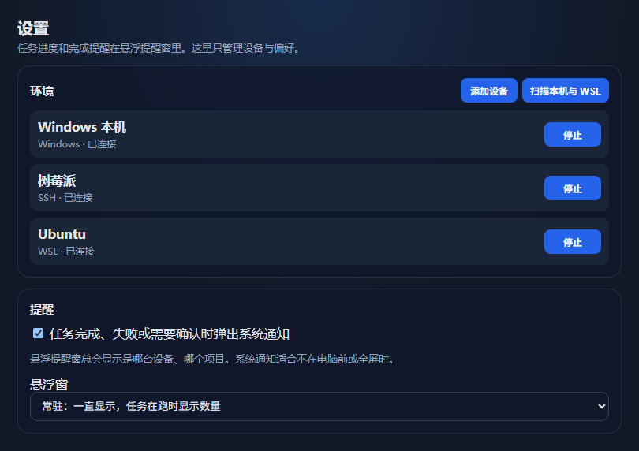

# VibeMate

在 Windows 桌面上查看本机、WSL 和远程 Linux 上的 AI 编码任务。Agent 跑测试时，悬浮胶囊显示还有几个任务在跑；轮到你确认、查看结果或处理故障时，它会显示设备名和任务标题。

[快速预览](#快速预览) · [运行桌面版](#运行桌面版) · [任务列表](#任务列表) · [开发与构建](#开发与构建)


*桌面端实际界面，使用模拟任务演示。*

## 快速预览

装有 Node.js 22+ 和 Git 的电脑可以直接运行浏览器演示。以下命令只启动预览服务，无需安装 npm 依赖或连接设备。

```sh
git clone https://github.com/underdmpd/vibemate.git
cd vibemate
node browser-preview/monitor-server.mjs
```

打开 [本地悬浮窗演示](http://127.0.0.1:18883/floating)，点「本机任务完成」，再点胶囊展开列表。浏览器使用模拟数据；真实窗口跳转和会话恢复需要 Windows 桌面版。

## 运行桌面版

**从源码启动** · 在 Windows 上安装 Node.js 22+ 和 Git，进入仓库目录后运行：

```sh
npm ci
npm run build:linux-payload
npm run start:desktop
```

**使用便携 ZIP** · 如果你已有发布包，Intel / AMD 电脑选 `x64`，Windows on Arm 电脑选 `arm64`。将 ZIP 完整解压到固定目录，双击 `VibeMate.exe`。便携版自带运行所需的文件；升级前先退出旧版。[查看 GitHub Releases](https://github.com/underdmpd/vibemate/releases)

### 连接第一台设备

1. 打开「设置」，点「扫描本机与 WSL」，启用要监控的环境。
2. 重新打开该环境里的 Agent 会话，发起一个任务。VibeMate 收到第一个生命周期 Hook 后，任务就会出现在悬浮窗里。
3. 接入 Linux 或树莓派时，点「添加设备」，填写 SSH 连接信息并测试连接。首次连接核对主机指纹，再点「安装并开始监控」，然后重新打开远端 Agent 会话。



*示例中的三套环境分别管理。常驻模式显示运行数量，安静模式在任务运行时缩成小圆点，有提醒时再展开。*

## 任务列表

| 你看到的状态 | 可以做什么 |
| --- | --- |
| **在跑** | 查看任务所在设备、项目和运行时长。 |
| **轮到你** | 查看本轮结果、待确认事项或错误摘要。点「回到任务」切回工作窗口；点「知道了」只把这次提醒标为已看，权限请求仍需处理。 |
| **最近任务** | 看过的任务仍可点「回到任务」返回已有窗口。切换期间按钮显示「正在切换…」。没有活跃任务时，面板默认显示最近三条，点「查看全部」可展开其余记录。 |

**「完成了」表示这一轮已有结果；「会话已结束」表示 Agent 会话已经收尾。** 已结束的本机 Codex CLI 和 Copilot CLI 会话可以点「在 Windows Terminal 继续」，在原项目目录用原会话 ID 恢复对话。原账号下需要仍有对应的历史记录。

### 支持哪些环境

桌面端支持 Windows 10 / 11 的 x64、ARM64。可监控的 Agent 包括 **Codex CLI、GitHub Copilot CLI、Claude Code 和 Antigravity**，需要使用支持相应 Hook 的版本。

| 任务运行位置 | 从面板返回任务 |
| --- | --- |
| Windows 本机 · VS Code | 激活已有窗口。有多个窗口时按项目名匹配；匹配不唯一时提示手动切换。 |
| Windows 本机 · 独立 Windows Terminal | 确认原窗口后显示「打开终端窗口」。窗口内的标签页由用户选择。 |
| WSL | 通过 VS Code 的 WSL 远程入口打开对应发行版和项目目录。 |
| SSH Linux / 树莓派 | 通过 VS Code 的 Remote SSH 入口打开远端项目，支持 x64 和 ARM64 设备。 |

### 提醒与隐私

- **模型请求失败或超时**：可重试的请求错误经过连续失败判定后再提醒。默认只在等待模型返回时计算 6 分钟超时，编译或测试耗时本身不会触发该提醒。
- **进程退出或设备掉线**：接收端在有可验证的 Agent 进程 ID 时检查进程存活。设备持续掉线 90 秒后才提醒。
- **任务内容**：面板使用限长、脱敏的任务标题和结果摘要，分别最多 60 和 120 个字符。Copilot 的结果摘要可从本机转录末尾提取。
- **远程连接**：首次连接需核对 SSH 主机指纹。密码和私钥口令仅保存在本次运行的内存中。

## 开发与构建

```sh
npm ci
npm run typecheck
npm test
npm run dist:windows
```

Windows 打包命令会构建桌面程序、窗口跳转助手和 Linux 端运行文件，并在 `release/` 下生成 x64 与 ARM64 两种便携 ZIP。

### 项目结构

Agent 的生命周期 Hook 通过 `hook-runner` 向同机 Receiver 上报事件。Receiver 将不同 Agent 的事件归一化为会话状态，桌面端汇总已连接环境并显示提醒。

| 目录 | 用途 |
| --- | --- |
| `apps/desktop` | Electron 桌面端、悬浮窗、设备设置与窗口跳转 |
| `packages/protocol`、`packages/core` | 事件协议、文本清理、会话状态与健康检查 |
| `packages/adapter-*`、`packages/receiver` | Agent 事件适配、本机接收服务与远程连接 |
| `packages/hook-runner`、`packages/hook-installer` | Hook 上报、安装、备份与卸载 |
| `browser-preview` | 复用桌面界面的浏览器演示与模拟数据 |

[产品需求](docs/product-requirements.md) · [系统架构](docs/current-architecture.md) · [悬浮提醒设计与实测记录](docs/handoff-reminder-redesign.md) · [反馈问题](https://github.com/underdmpd/vibemate/issues)
